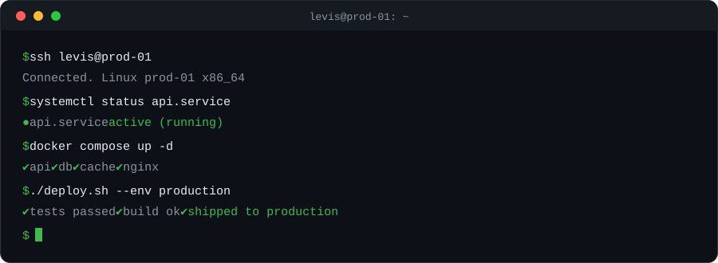

<div align="center">



<br/>

<a href="https://github.com/levisrabah">
  
</a>

<br/><br/>


<a href="mailto:levisrabah@gmail.com"></a>
<a href="https://www.linkedin.com/in/levis-rabah/"></a>
<a href="https://github.com/levisrabah?tab=repositories"></a>

<br/><br/>

### You bring the problem. I'll build it, put it online, and keep it running.

</div>

<br/>

## What I can do for you

<table>
<tr>
<td align="center" valign="top" width="33%">

### Websites
**A site you're proud of**

Portfolios and business websites that look right on a phone, a tablet or a laptop.

</td>
<td align="center" valign="top" width="33%">

### Your own product
**Turn an idea into something people use**

Software people log into and pay for, usually called SaaS. I build the accounts, the data side and the hosting.

</td>
<td align="center" valign="top" width="33%">

### Custom software
**Tools that fit how you work**

Portals, dashboards and internal systems built around what your team actually does day to day.

</td>
</tr>
<tr>
<td align="center" valign="top" width="33%">

### Automation
**Stop doing the same task twice**

Reports, data entry, reminders and other repetitive jobs that can run on their own.

</td>
<td align="center" valign="top" width="33%">

### Data and servers
**Keep it safe and online**

Your information stored properly, and the servers behind your site updated, backed up and watched.

</td>
<td align="center" valign="top" width="33%">

### Honest advice
**Know before you commit**

Not sure what to build, or whether what you already have is any good? I'll look at it and tell you straight.

</td>
</tr>
</table>

<div align="center">

Got something in mind? [Send me a few lines about it](#lets-talk).

</div>

---

## Does this sound like you?

| What you might be thinking | What I'd do |
| :--- | :--- |
| *"I need a website and I don't know where to start."* | Work out what you need with you, build it, and put it online. |
| *"My website is slow, broken, or nobody dares touch it."* | Fix it, update it, and keep an eye on it. |
| *"I have an idea for an app."* | Turn it into something people can actually use. |
| *"We spend hours every week on the same tasks."* | Make the computer do them. |
| *"I'm not sure our data and systems are safe."* | Sort out how they're organised, secured and backed up. |
| *"I'd like an honest second opinion."* | Review it and give you clear next steps. |

---

## How we'd work together

<div align="center">

| 1. You tell me | 2. I come back with a plan | 3. We build in small steps | 4. It's yours |
| :---: | :---: | :---: | :---: |
| Describe the problem. A short message is enough, no jargon needed. | Questions, a suggested approach, and what "finished" looks like. | You see and try things as we go, not just at the end. | Written up and tested, simple enough for you to run without me. |

</div>

---

## Selected work

<!--
  Add three or four projects here, with live website links first. For each one: the problem, what you did, and the result, in two lines.

  | Project | What it does | Built with |
  | :--- | :--- | :--- |
  | [project-name](https://github.com/levisrabah/project-name) | One sentence on the problem it solves and how. | Laravel, PostgreSQL, Docker |

  Or use repository cards:
  <a href="https://github.com/levisrabah/REPO"></a>
-->

<div align="center">

<a href="https://github.com/levisrabah?tab=repositories">
  
</a>

</div>

---

## The tools I use

*This part is for the technical folks.*

<div align="center">

**Languages**


**Frameworks and libraries**


**Databases (SQL and NoSQL)**


**Servers and delivery**


</div>

<details>
<summary><b>How I approach engineering</b></summary>

```js
const levis = {
  role: "Software Engineer",
  focus: "System design and getting things into production",
  also: "Consulting and working with other teams",
  builds: ["Portfolio sites", "Business websites", "SaaS products", "Automations"],

  languages: ["JavaScript", "TypeScript", "Python", "PHP", "C", "C++"],
  frameworks: {
    frontend: ["React", "Next.js", "Vue", "Tailwind CSS"],
    backend: ["Laravel", "Node.js", "Express", "Django"],
  },
  data: {
    sql: ["PostgreSQL", "MySQL"],
    nosql: ["MongoDB", "Redis"],
    work: ["Schema design", "Indexing and tuning", "Migrations", "Backups", "Database management systems"],
  },
  infrastructure: ["Linux", "Windows Server", "Docker", "AWS", "Nginx"],
  delivery: ["Git", "GitHub Actions", "PHPUnit", "Playwright"],

  principles: [
    "Model the data before writing the code",
    "Pick the simplest design that will hold up",
    "Test the parts that must never break: money, permissions, data isolation",
    "Write decisions down where the team can find them",
    "Ship in small changes that are easy to review",
  ],
};
```

</details>

### A typical deploy

<div align="center">
  
</div>

### From commit to production

<div align="center">
  
</div>

---

## GitHub activity

<div align="center">


<br/>


</div>

### Trophies

<div align="center">


</div>

### Contributions over time

<div align="center">


</div>

---

## Let's talk

Got a website to build, something to automate, a system that keeps breaking, or a decision you're stuck on? Send me a few lines about it and where you are so far. I'll write back with questions or a suggestion for what to do next.

<div align="center">

<a href="mailto:levisrabah@gmail.com?subject=Project%20enquiry&body=Hi%20Levis%2C%0A%0AHere%27s%20what%20I%20need%20help%20with%3A%0A%0A"></a>
<a href="https://www.linkedin.com/in/levis-rabah/"></a>

<br/><br/>

*First, solve the problem. Then, write the code.*

</div>
